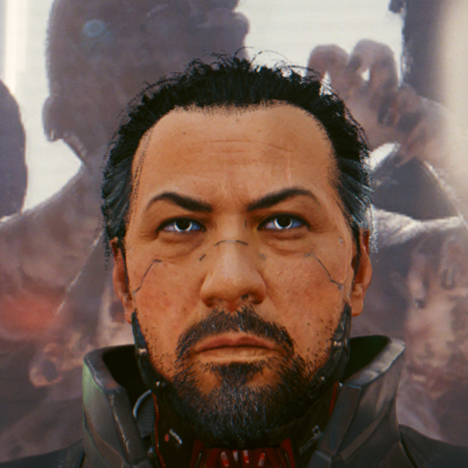
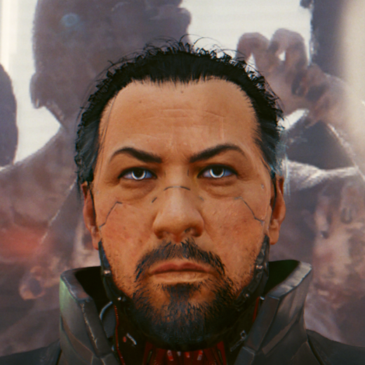
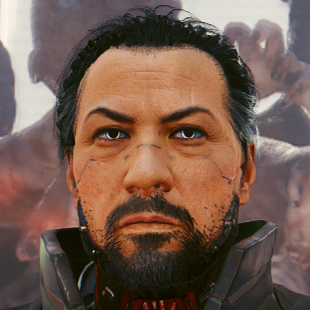
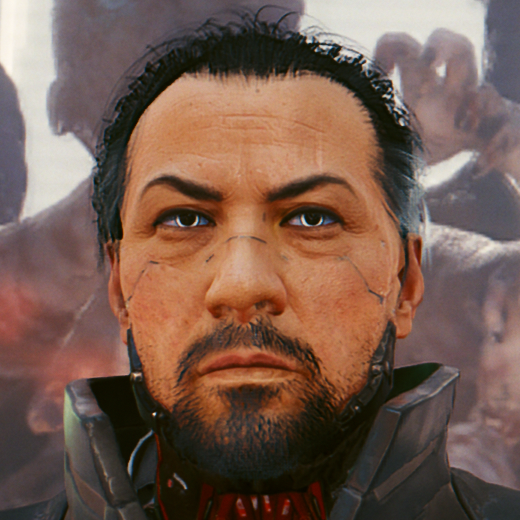

# Cyberpunk 2077 hair dither fix

Cyberpunk 2077 renders hair transparency with a per-pixel dither pattern that the upscaler is
supposed to smooth out over time. At low render resolutions, and with FSR in general, it stays
visible as grain. This mod replaces the dither with properly blended, translucent hair right
before FSR runs, and optionally sharpens the hair afterwards.

It doesn't modify any game data. It's a drop-in proxy for the game's FidelityFX loader DLL.

## Comparison

Crops at native screen resolution (2560×1440 output); look at the hairline, the beard and the
stubble on the jaw.

| | Fix off | Fix on |
|---|---|---|
| **FSR 2.1** |  |  |
| **FSR 3** |  |  |

## Requirements

- **FSR selected as the upscaler** in the game's graphics settings (any quality mode, including
  Native AA):
  - **FSR 3 / FSR 4**: tested on Linux with Proton (proton-cachyos 11, vkd3d-proton, RX 9070) and
    on Windows 11 (RX 9070 XT, Adrenalin 26.10.1, Steam overlay on), game version 2.x.
  - **FSR 2.1**: experimental, not yet confirmed in game. The game runs FSR 2.1 itself, and the mod
    recognises its passes by shader, so a game patch that changes them turns the fix off (see
    Troubleshooting). `StabilizeDepth` has no effect with FSR 2.1.
- With TAA, DLSS or XeSS the mod does nothing.

## Install

Download the archive for your system from the
[releases page](https://github.com/anatolijphp/cyberpunk-hair-render/releases): `...-windows.zip`
or `...-linux.tar.gz` (Steam with Proton). Both contain the same mod.

The game loads `bin/x64/amd_fidelityfx_loader_dx12.dll`. The installer renames the original to
`amd_fidelityfx_loader_dx12_orig.dll` and puts the mod in its place, plus `hairfix.ini`.

- **Linux / Proton:** `./install.sh "/path/to/steamapps/common/Cyberpunk 2077"`
- **Windows:** run `install.bat` and enter the game folder when asked (or pass it as an argument).

## Uninstall

`./uninstall.sh "<game folder>"` or `uninstall.bat` restores the original DLL. `hairfix.ini`
and `hairfix.log` are left behind; delete them by hand if you like.

A Steam "verify integrity of game files" also restores the original DLL. Run the installer again
afterwards if you want to keep the mod.

## Using it

- **Home** opens the settings overlay: toggles, dropdowns and sliders for every setting, applied
  live while you look at the game. **Save** writes `hairfix.ini`, **Reset to defaults** restores
  the defaults. While it's open the game doesn't receive mouse / keyboard input; Home or Esc closes it.
  The overlay and toggle keys are never passed to the game.
- **F10** toggles the fix on and off. A small "HAIR FIX ON / OFF" banner shows the state (and is
  shown for a few seconds at startup, so you can see the mod is loaded).
- Changes to `bin/x64/hairfix.ini` are picked up while the game runs (within half a second), so
  you can edit the file and watch the result. `Enabled`, `ToggleKey`, `OverlayKey` and
  `[Debug] DumpShaders / LogFrames` need a game restart. A newly selected sharpen preset compiles
  on first use, which causes a brief hitch.

## Settings (`bin/x64/hairfix.ini`)

| Key | Default | Meaning |
|---|---|---|
| `Enabled` | `true` | `false` disables everything; FSR is passed through untouched |
| `Coverage` | `raw` | `raw`: soft, translucent strands. `sharpen`: crisp strands with anti-aliased edges |
| `Resolve` | `strand` | `strand`: blend along the hair strands. `box`: plain 5×5 neighbourhood |
| `Strength` | `0.5` | 0 = keep the most strand detail ... 1 = smoothest |
| `StabilizeDepth` | `false` | give FSR stable depth / motion vectors on hair; can reduce flicker |
| `SharpenThreshold` | `0.3` | `Coverage = sharpen` only; presets 0.2 / 0.3 / 0.4 / 0.5 |
| `SharpenWidth` | `2.0` | `Coverage = sharpen` only; edge width in pixels, presets 1 / 1.5 / 2 / 3 |
| `UnsharpMask` | `true` | sharpen hair (and only hair) after the upscale |
| `USMAmount` | `1.0` | unsharp mask strength |
| `USMRadius` | `2.5` | unsharp mask blur radius, in screen pixels |
| `USMThreshold` | `0.05` | leave detail smaller than this (relative to brightness) alone |
| `ToggleKey` | `0x79` | virtual-key code of the toggle key (0x79 = F10) |
| `OverlayKey` | `0x24` | virtual-key code of the settings overlay key (0x24 = Home) |
| `[Debug] View` | `0` | 1 coverage, 2 hair-surface mask, 3 strand coherence, 4 unsharp-mask mask |
| `[Debug] LogFrames` | `false` | log hair draw counts every 1000 frames |
| `[Debug] DumpShaders` | `false` | dump the game's hair shaders to `bin/x64/hairfix_dump/` |
| `[Debug] ProbeUpscaler` | `false` | log the compute work of a few frames (to find FSR 2.1 after a patch); slow |

## Troubleshooting

- `bin/x64/hairfix.log` records what the mod found and did. After a game patch, if the hair
  shaders changed, the log says `unknown alpha_accum shader` and the mod leaves hair alone.
- FSR 2.1: the log says `fsr2: built-in FSR 2.1 found` once the fix is active. If that line never
  appears, the game's FSR 2.1 shaders changed: set `[Debug] ProbeUpscaler = true`, play for a minute
  with FSR 2.1 selected and report the log.
- Crash or black screen: set `Enabled = false`, or uninstall, and report the log.

## How it works

The game draws hair three times per frame: a transparency pass (multiplying each layer's
opacity), a colour pass, and a G-buffer pass. All three use the same stochastic dither test to
decide which pixels a strand covers. The mod:

1. Recognises those passes when the game creates their pipelines (by render-target formats,
   blend and stencil state) and re-issues every hair transparency draw a second time with its
   own pixel shader: the game's shader logic without the dither. That yields true per-pixel
   coverage and the game's hair-surface mask, without changing the game's own rendering.
2. Right before FSR, a compute pass blends each pixel from neighbouring hair and background
   samples, weighted by that coverage (optionally along the local strand direction), and hands
   FSR the resolved image.
3. After FSR, an optional unsharp mask restores strand contrast, masked to hair.

Steps 2 and 3 hook into FSR in one of two ways:

- **FSR 3 / 4** (`src/fsr3.cpp`): the game calls FSR through the FidelityFX API in
  `amd_fidelityfx_loader_dx12.dll`. The proxy DLL swaps the colour input in the upscale call.
- **FSR 2.1** (`src/fsr2.cpp`): the game runs FSR 2.1 as its own compute passes, with no DLL call
  to intercept. The mod recognises those passes by shader hash, finds their input colour and output
  through the descriptors they bind (`src/descriptors.cpp`) and inserts its work into the game's
  command list before the first pass and after the last one. The resolved image is copied over the
  input colour in place. The game's compute bindings are restored after each insertion.

## Building

Needs [llvm-mingw](https://github.com/mstorsjo/llvm-mingw) and Microsoft's
[DirectX Shader Compiler](https://github.com/microsoft/DirectXShaderCompiler) (Linux build).
Set `LLVM_MINGW` and `DXC` if they're not in the default locations, then run `./build.sh`.
`./package.sh` builds the release archives in `dist/`. The GitHub Actions workflow
(`.github/workflows/build.yml`) does the same on every push and publishes a GitHub Release with
both archives when a `v*` tag is pushed.

## Third-party code

- `third_party/FidelityFX`: AMD FidelityFX API headers (MIT licence).
- `third_party/imgui`: [Dear ImGui](https://github.com/ocornut/imgui) v1.93.0 with its Win32 and
  DX12 backends (MIT licence).

See `THIRD_PARTY_NOTICES.md`.
