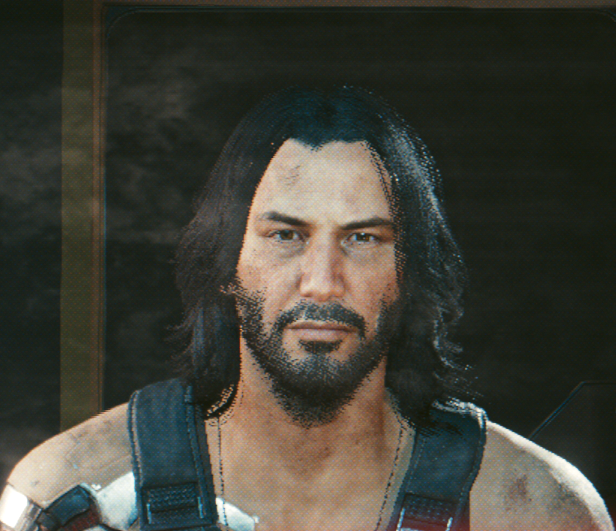
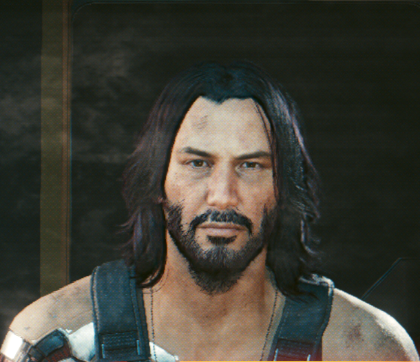

# Cyberpunk 2077 hair dither fix

Cyberpunk 2077 renders hair transparency with a per-pixel dither pattern that the upscaler is
supposed to smooth out over time. At low render resolutions, and with FSR in general, it stays
visible as grain. This mod replaces the dither with properly blended, translucent hair right
before FSR runs, and optionally sharpens the hair afterwards. An optional small neural network
(`Resolve = neural`) refines the blended hair from the game's raw frame for more strand detail.
Hair in mirrors, which the game renders as a view of its own without FSR or temporal AA (so the dither
there is raw grain), gets the same treatment, with settings of its own.

It doesn't modify any game data. It's a drop-in proxy for the game's FidelityFX loader DLL.

## Comparison

Hair from 2560×1440 screenshots (**FSR 2.1** performance, **FSR 3/4** ultra performance), zoomed 2× without smoothing so every screen pixel shows. Without
the fix the hairline is a grainy dither pattern; with it the strands are soft and translucent.

| | Fix off | Fix on |
|---|---|---|
| **FSR 2.1** |  |  |
| **FSR 3/4** |  |  |
| **Mirror** |  |  |

The mirror row is a crop of a 2560×1440 screenshot (FSR 3 Quality), not zoomed. A mirror is rendered
without FSR or temporal AA, so without the fix its hair and beard show the raw dither.

## Requirements

- **FSR selected as the upscaler** in the game's graphics settings (any quality mode, including
  Native AA):
  - **FSR 3 / FSR 4**: tested on Linux with Proton (proton-cachyos 11, vkd3d-proton, RX 9070) and
    on Windows 11 (RX 9070 XT, Adrenalin 26.10.1, Steam overlay on), game version 2.x.
  - **FSR 2.1**: tested on Windows 11 (RX 9070 XT, Adrenalin 26.10.1), game version 2.x. The game
    runs FSR 2.1 itself, and the mod recognises its passes by shader, so a game patch that changes
    them turns the fix off (see Troubleshooting). `StabilizeDepth` has no effect with FSR 2.1.
- With TAA, DLSS or XeSS the mod does nothing.

## Install

Download the archive for your system from the
[releases page](https://github.com/anatolijphp/cyberpunk-hair-render/releases): `...-windows.zip`
or `...-linux.tar.gz` (Steam with Proton). Both contain the same mod.

The game loads `bin/x64/amd_fidelityfx_loader_dx12.dll`. The installer renames the original to
`amd_fidelityfx_loader_dx12_orig.dll` and puts the mod in its place, plus `hairfix.ini` and the
network model `hairfix_resolve.bin`. An existing `hairfix.ini` is kept, the model is replaced.

- **Linux / Proton:** `./install.sh "/path/to/steamapps/common/Cyberpunk 2077"`
- **Windows:** run `install.bat` and enter the game folder when asked (or pass it as an argument).

## Uninstall

`./uninstall.sh "<game folder>"` or `uninstall.bat` restores the original DLL. `hairfix.ini`,
`hairfix.log` and `hairfix_resolve.bin` are left behind; delete them by hand if you like.

A Steam "verify integrity of game files" also restores the original DLL. Run the installer again
afterwards if you want to keep the mod.

## Using it

- **Home** opens the settings overlay: toggles, dropdowns and sliders for every setting, applied
  live while you look at the game. **Save** writes `hairfix.ini`, **Reset to defaults** restores
  the defaults. While it's open the game doesn't receive mouse / keyboard input; Home or Esc closes it.
  The overlay and toggle keys are never passed to the game.
- **F10** toggles the fix on and off. A small "HAIR FIX ON / OFF" banner shows the state (and is
  shown for a few seconds at startup, so you can see the mod is loaded).
- Changes to `bin/x64/hairfix.ini` are picked up while the game runs (within half a second), so
  you can edit the file and watch the result. `Enabled`, `ToggleKey`, `OverlayKey` and
  `[Debug] DumpShaders / LogFrames` need a game restart. A newly selected sharpen preset compiles
  on first use, which causes a brief hitch.

## Settings (`bin/x64/hairfix.ini`)

| Key | Default | Meaning |
|---|---|---|
| `Enabled` | `true` | `false` disables everything; FSR is passed through untouched |
| `Coverage` | `raw` | `raw`: soft, translucent strands. `sharpen`: crisp strands with anti-aliased edges |
| `Resolve` | `strand` | `strand`: blend along the hair strands. `box`: plain 5×5 neighbourhood. `neural`: strand, refined by a network (see below) |
| `Strength` | `0.65` | 0 = keep the most strand detail ... 1 = smoothest |
| `Area` | `0` | where the mod works: how far (render pixels) from strand edges into fully filled hair, where no background shows through. Outside, the image is the game's own, as without the mod. 16 = all hair |
| `AreaFeather` | `9.5` | width (render pixels) of the soft transition beyond the area's border; 0.5 = hard |
| `StabilizeDepth` | `true` | give FSR stable depth / motion vectors on hair; can reduce flicker |
| `SharpenThreshold` | `0.3` | `Coverage = sharpen` only; presets 0.2 / 0.3 / 0.4 / 0.5 |
| `SharpenWidth` | `2.0` | `Coverage = sharpen` only; edge width in pixels, presets 1 / 1.5 / 2 / 3 |
| `UnsharpMask` | `true` | sharpen hair (and only hair) after the upscale |
| `USMAmount` | `1.15` | unsharp mask strength |
| `USMRadius` | `2.99` | unsharp mask blur radius, in screen pixels |
| `USMThreshold` | `0.01` | leave detail smaller than this (relative to brightness) alone |
| `Mirror` | `true` | also fix hair in mirrors, with the `[Mirror]` settings below |
| `ToggleKey` | `0x79` | virtual-key code of the toggle key (0x79 = F10) |
| `OverlayKey` | `0x24` | virtual-key code of the settings overlay key (0x24 = Home) |
| `[Debug] View` | `0` | 1 coverage, 2 hair-surface mask, 3 strand coherence, 4 unsharp-mask mask, 5 network mask, 6 network correction (grey = none), 7 mod area (red = hair outside it) |
| `[Debug] LogFrames` | `false` | log hair draw counts every 1000 frames |
| `[Debug] DumpShaders` | `false` | dump the game's hair shaders to `bin/x64/hairfix_dump/` |
| `[Debug] ProbeUpscaler` | `false` | log the compute work of a few frames (to find FSR 2.1 after a patch); slow |
| `[Debug] CaptureKey` | `0` | key that records training data (see `training/README.md`); 0 = off, `0x77` = F8 |

`[Mirror]`: the same settings for hair in mirrors. A mirror is rendered at its own resolution
(scaled to how much of the screen it covers) and stretched onto the mirror surface, without FSR, so
its sharpening works in the mirror's own pixels.

| Key | Default | Meaning |
|---|---|---|
| `Resolve` | `strand` | `box`, `strand` or `neural`, as above |
| `Strength` | `0.65` | as above |
| `Area` / `AreaFeather` | `0` / `12.6` | as above, in mirror pixels |
| `UnsharpMask` | `true` | sharpen the mirror's hair after the resolve |
| `USMAmount` | `1.65` | unsharp mask strength |
| `USMRadius` | `2.52` | blur radius, in mirror pixels |
| `USMThreshold` | `0` | leave detail smaller than this (relative to brightness) alone |

## Neural resolve (`Resolve = neural`)

A small network (a 12-channel U-Net, 54k weights) refines the strand resolve at render resolution,
before FSR. It looks at the mod's resolve, the hair coverage, the local strand direction and the
game's raw dithered frame. It was trained to reproduce what the game renders at Native AA, so FSR
gets sharper, more strand-like hair to work with. It changes hair pixels only.

- Best together with the unsharp mask, at `Strength = 0.65` (the value it was trained with).
- Cost on an RX 9070 XT: about 0.5–2 ms per frame, depending on how much of the screen is hair.
  It uses 16-bit maths where the GPU supports it (shader model 6.4) and needs ~140 MB of GPU memory.
- Without `hairfix_resolve.bin` next to the mod it falls back to the strand resolve.
- `[Mirror] Resolve = neural` runs the same network on mirrors, with buffers of its own (another
  ~140 MB while a mirror is in view). It was trained on the main view's frames, which go through
  FSR; mirrors don't.
- The shipped model was trained on a single character at FSR 3 Ultra Performance (853×480 →
  2560×1440). It works at other qualities and with FSR 2.1, but other hairstyles and resolutions
  weren't in its training data. `training/README.md` explains how to capture your own data and
  retrain it.
- The shipped model was trained with v0.3.0, which stored the hair coverage in 8 bits. Since
  v0.3.1 the coverage is 16-bit, so faint strands no longer drop out of it. The model works
  unchanged with that (only thin strands look a little denser to it), but a model retrained
  on captures from v0.3.1 or later would match the new coverage exactly.

## Troubleshooting

- `bin/x64/hairfix.log` records what the mod found and did. After a game patch, if the hair
  shaders changed, the log says `unknown alpha_accum shader` and the mod leaves hair alone.
- FSR 2.1: the log says `fsr2: built-in FSR 2.1 found` once the fix is active. If that line never
  appears, the game's FSR 2.1 shaders changed: set `[Debug] ProbeUpscaler = true`, play for a minute
  with FSR 2.1 selected and report the log.
- Mirrors: the log says `mirror: resolve recorded after the mirror's final pass` once a mirror's
  hair is resolved, and every 10 seconds a `mirror:` line counts the hair draws per view, the mirror
  passes recorded or skipped, and at submission how many found the mirror's image (`image found`)
  or were left alone (`not the mirror's`, `list reset`). After a game patch that changes the
  mirror's final pass, the mod looks for it by its inputs and logs `mirror: final pass found` when
  it has it again.
- Crash or black screen: set `Enabled = false`, or uninstall, and report the log.

## How it works

The game draws hair three times per frame: a transparency pass (multiplying each layer's
opacity), a colour pass, and a G-buffer pass. All three use the same stochastic dither test to
decide which pixels a strand covers. The mod:

1. Recognises those passes when the game creates their pipelines (by render-target formats,
   blend and stencil state) and re-issues every hair transparency draw a second time with its
   own pixel shader: the game's shader logic without the dither. That yields true per-pixel
   coverage and the game's hair-surface mask, without changing the game's own rendering.
2. Right before FSR, a compute pass blends each pixel from neighbouring hair and background
   samples, weighted by that coverage (optionally along the local strand direction), and hands
   FSR the resolved image. With `Resolve = neural`, the network (`src/neural.cpp`,
   `shaders/nn_*.hlsl`: one compute dispatch per layer, only around the hair) corrects that image
   first.
3. After FSR, an optional unsharp mask restores strand contrast, masked to hair.

With `Area` below 16, two more passes after step 2 measure each pixel's distance to the nearest
strand edge. Deeper inside fully filled hair FSR gets the game's own colour (and depth / motion),
and the unsharp mask leaves it alone, with a soft transition at the border.

Steps 2 and 3 hook into FSR in one of two ways:

- **FSR 3 / 4** (`src/fsr3.cpp`): the game calls FSR through the FidelityFX API in
  `amd_fidelityfx_loader_dx12.dll`. The proxy DLL swaps the colour input in the upscale call.
- **FSR 2.1** (`src/fsr2.cpp`): the game runs FSR 2.1 as its own compute passes, with no DLL call
  to intercept. The mod recognises those passes by shader hash, finds their input colour and output
  through the descriptors they bind (`src/descriptors.cpp`) and inserts its work into the game's
  command list before the first pass and after the last one. The resolved image is copied over the
  input colour in place. The game's compute bindings are restored after each insertion.

### Mirrors

A mirror is a second view of the scene with its own depth buffer, rendered before the main view at a
size that follows how much of the screen it covers, without FSR or temporal AA. Its hair goes
through the same three passes, so the mod's coverage pass sees it too. The mod (`src/hair.cpp`,
`src/fsr2.cpp`):

- tracks depth-stencil views, so it knows each hair draw's depth buffer. The main view's is learned
  at the upscale; hair drawn into any other goes to a separate set of coverage targets, so it never
  reaches the main view's resolve;
- recognises the mirror view's final compute pass (it turns the mirror's lit colour into the image the
  mirror shows) by its shader hash, or, after a patch, by its bindings: one RGBA16F texture of the
  mirror's size read, one written;
- inserts its work right after that pass, on copies of its own: the pass's output is copied, the
  copy resolved (with the network, the area passes and the unsharp mask, using the `[Mirror]`
  settings) and the result written back.

The mirror's hair and its final pass are recorded on different command lists, in parallel, and the
mirror's textures are new every frame. While a list is being recorded, the descriptor of the pass's
output may still point at an older texture: the game may write it later, before it submits the
list. So the mod reaches the mirror's image only through a descriptor of its own, filled from the
game's final descriptor in `ExecuteCommandLists`, and only if it is the mirror's image (RGBA16F, the
size of the mirror's hair); otherwise the copies do nothing and the mirror is left as the game drew
it. On the GPU the hair is drawn first, then the mirror pass, then the mod's work; the coverage
targets are cleared after the main view's upscale.

## Building

Needs [llvm-mingw](https://github.com/mstorsjo/llvm-mingw) and Microsoft's
[DirectX Shader Compiler](https://github.com/microsoft/DirectXShaderCompiler) (Linux build).
Set `LLVM_MINGW` and `DXC` if they're not in the default locations, then run `./build.sh`.
`./package.sh` builds the release archives in `dist/`. The GitHub Actions workflow
(`.github/workflows/build.yml`) does the same on every push and publishes a GitHub Release with
both archives when a `v*` tag is pushed. The network model is `models/hairfix_resolve.bin`; the
tools that capture training data and train it are in `training/` (see `training/README.md`).

## Third-party code

- `third_party/FidelityFX`: AMD FidelityFX API headers (MIT licence).
- `third_party/imgui`: [Dear ImGui](https://github.com/ocornut/imgui) v1.93.0 with its Win32 and
  DX12 backends (MIT licence).

See `THIRD_PARTY_NOTICES.md`.
